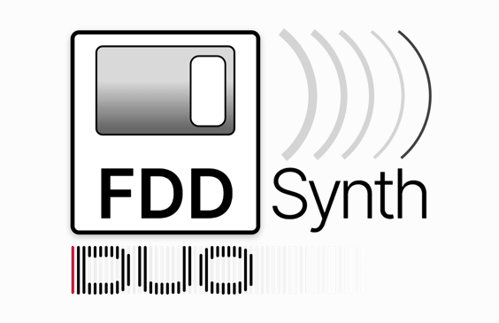
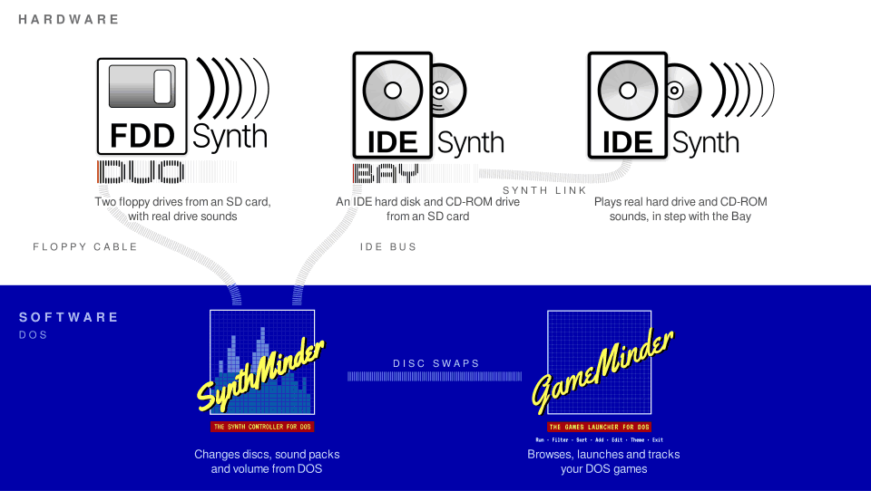

  

<h3 align="center">Two floppy drives from a microSD card like GoTek, but it sounds like the real thing</h3>

  
  

**Status:** working in a real PC (DOS reads, writes and FORMAT) and an Amiga 1200 (Workbench, Robocod, Turrican), on a prototype carrier board. The integrated board, rev C, is under production. Formerly FDD Synth Pro. [Status and testing](docs/status.md).

  
   
  FDD Synth Pro: First look (click to watch on YouTube)

## Features

- **It is the FDD:** connects via floppy cable as one or two drives, A and B, each with its own disk image from the microSD card, swapped from the front panel like a GoTek.
- **Every disk you have:** PC disks from 160 KB to 1.68 MB, Amiga ADFs other machines' disks through GoTek's `IMG.CFG`, and HFE flux images that keep their copy protection. Writes and FORMAT go back into the image.
- **PCs, Amigas and more:** a PC past a twist or on a straight cable, Shugart hosts (Atari ST, Amstrad, synths and samplers) and an Amiga's microsecond selects at hardware speed.
- **Sounds like a real drive:** because it *is* the drive, it knows every motor start and head step and plays them with a sample pack: clicks, seeks, bumps at the end stops, disk changes.
- **A front panel:** an OLED with a live head trace, a rotary encoder for the volume and the disk list and eject. It remembers the last disk, sample pack and  volume.

## Quick start

1. **Flash the firmware:** hold **BOOTSEL** while plugging the board into USB, then copy `.uf2` from the [latest release](https://github.com/MaverickUK/FDDSynthDuo/releases/latest) onto the `RP2350` drive. (The `-direct-` builds are for a rig without the SN7407, never a real PC.)
2. **Make a card:** copy disk images (`.IMG`, `.ADF`, `.HFE`) to the root of a microSD card (FAT32 or exFAT). Without any, the drive serves a welcome disk that explains the rest.
3. **Fit it:** connect the floppy cable and power with the computer off.
4. **Turn the computer on:** the drive serves the first image in name order. Press the rotary encoder to pick another; for two drives or another machine, edit `FDDSYNTH.CFG` ([settings](docs/config.md)).

## Documentation

| Page | What it covers |
|---|---|
| [Settings](docs/config.md) | `FDDSYNTH.CFG`: drive A, B or both, the interface, the cable, the starting disks |
| [Status and testing](docs/status.md) | What works, the machines it has run on, what's next |
| [The front panel](docs/front-panel.md) | The controls and every screen |
| [The sounds](docs/activity.md) | How the drive's actions become sound events, and the sample packs |
| [SynthMinder](docs/synthminder.md) | Setting the drive up from DOS, through cylinder 82 |
| [Wiring](docs/wiring.md) and [the hardware](hardware/README.md) | The connections, the carrier board, and [rev C](docs/pcb-revc.md) |
| [Building and testing](docs/building.md) | The builds, the tests, the rig, and the deeper technical pages |
| [Changelog](firmware/CHANGELOG.md) | Every release |

## The Synth family

  

- [IDE Synth](https://github.com/MaverickUK/IDESynth): plays the sound of hard drives and optical drives, real drives sampled or modelled from physics, in step with the Bay
- [IDE Synth Bay](https://github.com/MaverickUK/IDESynthBay): an IDE hard disk and CD-ROM drive served from a microSD card, telling the IDE Synth exactly what it does
- **FDD Synth Duo** (this one): two floppy drives served from a microSD card, with real drive sounds
- [SynthMinder](https://github.com/MaverickUK/SynthMinder): the synth controller for DOS, changing discs, sound packs and the volume from the PC they're fitted to
- [GameMinder](https://github.com/MaverickUK/GameMinder): the games launcher for DOS, which browses, launches and keeps track of your DOS games
- [FDDBench](https://github.com/MaverickUK/FDDBench): floppy sounds and a benchmark for DOS

## Licence and credits

The licence is to be decided (the IDE Synth's firmware is GPL-3.0).

The rig uses Adafruit's Floppy FeatherWing and its Greaseweazle-compatible firmware, and the tests read the drive's output back with [Greaseweazle](https://github.com/keirf/greaseweazle)'s own decoder. Disk formats for other machines follow [FlashFloppy](https://github.com/keirf/flashfloppy)'s `IMG.CFG`.
