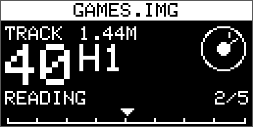
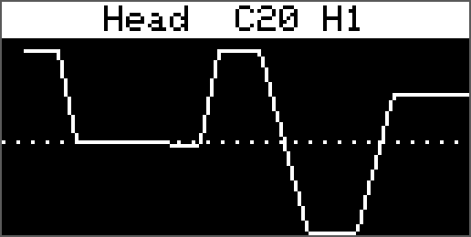

# The front panel

The screen, the knob and the action button. Back to the [README](../README.md).

An SSD1306 OLED on the BB48's Qwiic socket, a rotary encoder and an action button, as on the IDE Synth. Like a GoTek, the drive remembers the disk, the pack and the volume across power-off.

| Control | Does |
|---|---|
| Turn | The volume; in a list, move up and down |
| Press | The list of disks, to pick one and insert it (on the Sounds screen: the sample packs) |
| Action | The next screen; in a list, back |
| Long action | Eject the disk, or put it back |

`<Eject disk>` is first in the disk list, so the drive can be left empty from there too.

 

[docs/oled](oled) has every screen, drawn by the firmware's own code. The wiring is in [wiring.md](wiring.md); the parts in [parts.md](parts.md).
